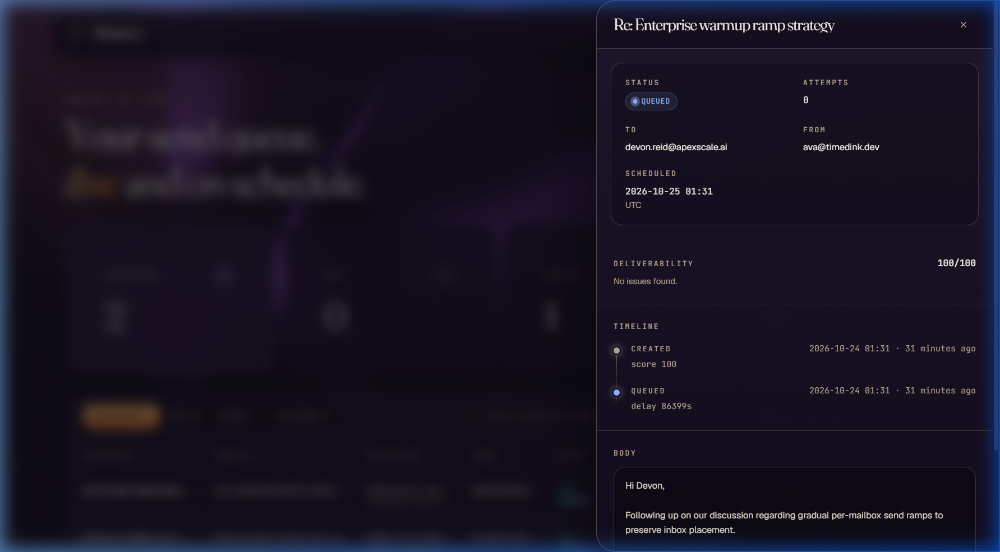
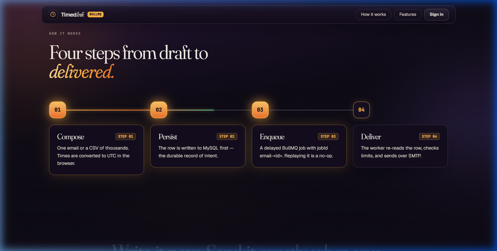
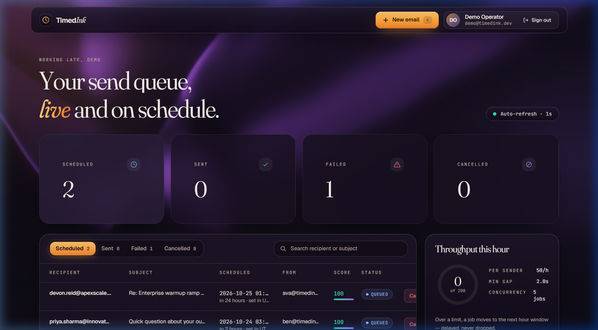
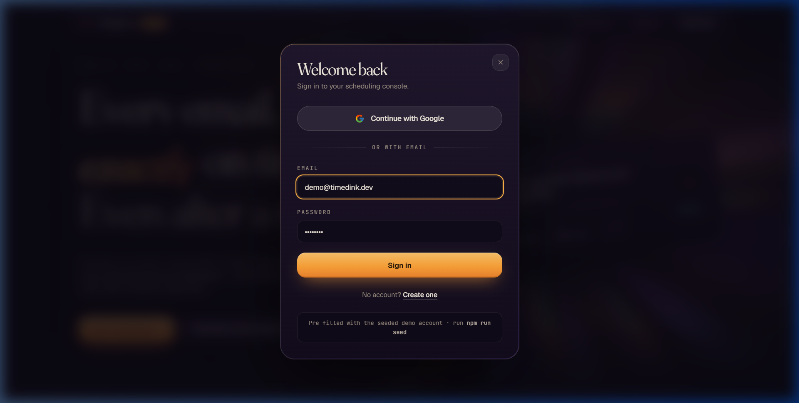
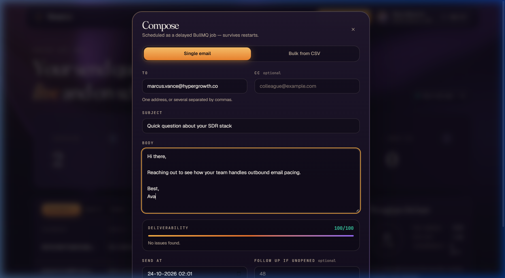

<div align="center">

# TimedInk

### Fault-Tolerant, Rate-Paced Email Scheduler

**Write it now — send it exactly when intended.**<br />
Guaranteed delivery through process restarts, a wiped Redis cache, and strict provider throttle ceilings.

<br />

<p>
  <a href="https://timed-ink.vercel.app"></a>
  &nbsp;
  <a href="https://timedink.onrender.com/health"></a>
  &nbsp;
  <a href="ASSUMPTIONS.md"></a>
</p>

<p>
  
  
  
  
  
  
</p>

<br />

<p align="center">
  
</p>

</div>

---

| | |
| --- | --- |
| **Email Transport** | Nodemailer → [Ethereal](https://ethereal.email) — every send generates a viewable preview link |
| **Hermetic Tests** | 73 unit & integration tests — zero database, Redis, or SMTP containers required |
| **Setup Time** | ~4 minutes, zero-config embedded SQLite out of the box |

---

## Contents

- [The three hard parts](#the-three-hard-parts)
- [Quick start](#quick-start)
- [Running the app](#running-the-app)
- [Ethereal Email](#ethereal-email)
- [Architecture](#architecture)
  - [Scheduling](#scheduling)
  - [Restart persistence](#restart-persistence)
  - [Rate limiting and concurrency](#rate-limiting-and-concurrency)
- [Data model](#data-model)
- [Bonus layers](#bonus-layers)
- [Feature-to-code map](#feature-to-code-map)
- [API reference](#api-reference)
- [Interface](#interface)
- [Tests](#tests)
- [Configuration](#configuration)
- [Verification & system proofs](#verification--system-proofs)
- [Video walkthrough](#video-walkthrough)
- [Troubleshooting](#troubleshooting)
- [Deploying](#deploying)
- [What I'd build next](#what-id-build-next)

---

## The three hard parts

Everything else in this brief is CRUD. These three are where the design decisions live, so here
they are up front, each with the evidence that it actually works.

### 1. A scheduled email must survive the queue losing its memory

MySQL is the source of truth; Redis is a *derived index* of outstanding work that can be rebuilt
at any moment. Every boot replays the database's intent onto the queue using a job id derived
from the row's primary key, so replaying is a no-op when the job is still there.

```
# Redis wiped completely, then the API restarted:
$ docker exec outbox-redis redis-cli FLUSHALL
$ docker exec outbox-redis redis-cli ZCARD bull:outbox-emails:delayed   → 0

reconciliation complete: 3 job(s) re-queued, 0 flagged stale, 0 error(s) from 3 candidate(s) in 96ms

$ docker exec outbox-redis redis-cli ZCARD bull:outbox-emails:delayed   → 3
```

And with Redis **intact**, the same sweep is a no-op rather than a duplicate — 3 candidates
re-queued, delayed set still 3, not 6.

### 2. A provider will throttle you, so the queue has to pace itself

40 emails submitted at once, drained by a worker capped at 10 sends per 10 seconds:

```
  t+ 0s.. 9s : 14 sends  ##############   ← initial admission, then the limiter engages
  t+10s..19s :  6 sends  ######
  t+20s..29s : 10 sends  ##########
  t+30s..39s : 10 sends  ##########
  total 40 sends over 35 seconds
```

Without the limiter these would have gone out in about two seconds.

### 3. You have to be able to answer "why did this send at 3am?"

Every status transition writes an immutable `EmailEvent`. Clicking any recipient in the dashboard
opens its full timeline — this is a real one, from an email that lived through three restarts:

```
CREATED   2026-08-31 02:30   score 100
QUEUED    2026-08-31 02:30   delay 600s
QUEUED    2026-08-31 02:30   delay 576s     ← reconciler, restart #1
QUEUED    2026-08-31 02:31   delay 554s     ← reconciler, restart #2 (after FLUSHALL)
QUEUED    2026-08-31 02:31   delay 525s     ← reconciler, restart #3
SENDING   2026-08-31 02:40   attempt 1
SENT      2026-08-31 02:40   attempt 1
OPENED    2026-08-31 02:41   pixel
```

The shrinking delays are the reconciler recomputing `scheduledAt - now` on each boot.

<p align="center">
  
</p>

---

## Quick start

**Prerequisites:** Node 22+, and Redis (via `docker compose up -d` or a local/cloud Redis). No external MySQL database setup required — SQLite is embedded out of the box.

```bash
# 1. Start Redis
docker compose up -d

# 2. Setup backend
cd backend && npm install && cp .env.example .env

# 3. Synchronize database schema & seed demo account
npx prisma db push && npm run seed
```

Now start the **API** and the **worker** in two terminals:

```bash
npm run dev
```

```bash
npm run worker
```

…and the frontend in a third:

```bash
cd frontend && npm install && npm run dev
```

Open **<http://localhost:5173>** and sign in — the form is pre-filled with the seeded account:

```
email:    demo@timedink.dev
password: demo1234
```

### Google sign-in (OAuth 2.0)

A configured Google Client ID is provided in `.env.example` and authorized for both `localhost:5173` and `https://timed-ink.vercel.app`. Clicking **Continue with Google** opens Google's native Identity Services prompt, verifies the returned ID token server-side, and establishes a session. Email + password authentication (`demo@timedink.dev`) remains active alongside it.

| Surface | URL |
| --- | --- |
| Dashboard | <http://localhost:5173> |
| API health | <http://localhost:4000/health> |
| Bull Board (queue inspector) | <http://localhost:4000/admin/queues> |

> The `JWT_SECRET` in `.env.example` is a placeholder that works locally. Change it before this
> runs anywhere real — the app refuses to boot if it is under 16 characters.

---

## Running the app

### Infrastructure

`docker compose up -d` starts two containers and nothing else:

- **MySQL 8** on host port **3307** (mapped to 3306 inside). Deliberately not 3306, so it cannot
  collide with a MySQL already installed on the reviewer's machine.
- **Redis 7** on **6379**, with `--appendonly yes`. AOF persistence means delayed jobs survive
  `docker compose restart redis` on their own — that is one half of the restart story; the boot
  reconciler is the half that matters.

Both have healthchecks, so `docker compose ps` tells you when they are genuinely ready rather
than merely started.

### Two backend processes

```bash
npm run dev        # API on :4000  — HTTP, validation, boot reconciliation
npm run worker     # worker        — drains the queue, talks to SMTP
```

Split for the usual reason: a wedged SMTP connection must not be able to make the HTTP tier
unresponsive, and the two scale on completely different axes. They share only MySQL and Redis, so
you can run several of either.

| Command | What it does |
| --- | --- |
| `npm test` | full Vitest suite (no containers needed) |
| `npm run typecheck` | `tsc --noEmit` under `strict` |
| `npm run build` / `npm start` | compile to `dist/` and run the compiled API |
| `npm run seed` | idempotent demo user + two mailboxes |
| `npm run burst -- --count=40` | submit 40 emails at once to demo the rate limiter |
| `npx prisma studio` | browse the database |

### Frontend

```bash
cd frontend && npm install && npm run dev     # http://localhost:5173
```

The Vite dev server proxies `/api` to `localhost:4000`, so the browser stays on a single origin
and there is no CORS preflight on every dashboard poll. Deployed, `vercel.json` does the same job
with an `/api/*` rewrite — so which server answers is a proxy concern, never something baked into
the bundle.

---

## Ethereal Email

Ethereal is a fake SMTP service: it accepts mail, delivers nothing, and gives you a web page per
message. Ideal for a demo — real SMTP behaviour, plus a link you can open on camera.

**You do not need to create an account.** On first boot the worker calls
`nodemailer.createTestAccount()`, provisions a throwaway inbox, and logs the credentials once:

```
INFO: provisioned a throwaway Ethereal account
INFO: Pin these into backend/.env to keep one inbox across restarts:
  ETHEREAL_USER=igc3jypu3xblsw3o@ethereal.email
  ETHEREAL_PASS=…
```

Paste those into `backend/.env` and restart the worker. Without pinning, every restart creates a
*new* inbox — old preview links keep working, but you can no longer browse the old account.

**Finding a sent email's preview:** the **Sent** tab has a `Preview ↗` link on every row, and the
detail drawer has an *Open preview* button. It is `getTestMessageUrl()`, captured at send time
onto `ScheduledEmail.previewUrl`, so it is in the API response and the worker log too.

> ### Ethereal never delivers to a real inbox
>
> This trips people up, so it is worth stating plainly: Ethereal **accepts** your message, hands
> back a preview URL, and then **discards it**. Sending to your own Gmail will show `SENT` with a
> working preview link, and nothing will ever arrive. That is the service working as designed —
> it exists so you can exercise real SMTP without mailing real people. The app logs
> `delivery: capture-only` at boot whenever the host is Ethereal.

### Sending real mail

Nothing in the code is Ethereal-specific. `SMTP_USER` / `SMTP_PASS` are the same credential slot
as `ETHEREAL_USER` / `ETHEREAL_PASS` and take precedence, so pointing at a real provider is
configuration only:

```bash
# backend/.env — Gmail example
SMTP_HOST=smtp.gmail.com
SMTP_PORT=587
SMTP_SECURE=false
SMTP_USER=you@gmail.com
SMTP_PASS=<16-char app password>     # needs 2FA on, then generate an App Password
```

Brevo (`smtp-relay.brevo.com:587`, 300/day free) and Resend (`smtp.resend.com:587`, user
`resend`, password = API key) work the same way.

**One gotcha:** the `From` header comes from the `Mailbox` row, and providers only let you send
from an address you have verified — Gmail rewrites a mismatched `From` to the authenticated
account. Point the seeded mailboxes at an address you own:

```bash
SEED_MAILBOX_A_EMAIL=you@gmail.com
SEED_MAILBOX_B_EMAIL=you@gmail.com
```

then `npm run seed` again. (Or edit them live via `POST /api/mailboxes` / `npx prisma studio`.)

Verified working against Gmail: auth in ~2.1s, `delivery: "real"` in the boot log, message
delivered to a live inbox.

---

## Architecture

Three processes, two datastores:

```
   browser                    API process                    worker process
  ┌────────┐   HTTP    ┌──────────────────────┐        ┌──────────────────────┐
  │ React  │ ────────▶ │ express + zod        │        │ BullMQ Worker        │
  │ + Query│           │ auth, validation     │        │ concurrency + limiter│
  └────────┘           │ boot reconciliation  │        │ Nodemailer → Ethereal│
       ▲               └───────┬──────────────┘        └────────┬─────────────┘
       │  poll 4s              │                                │
       └───────────────────────┼────────────────────────────────┘
                               ▼                                ▼
                        ┌─────────────┐                  ┌─────────────┐
                        │  Database   │ ◀─── truth ───▶  │    Redis    │
                        │(SQLite/SQL) │                  │  (BullMQ)   │
                        └─────────────┘                  └─────────────┘
```

The single most important decision: **The database is the source of truth, Redis is a derived index of
outstanding work.** Every scheduled email exists as a row before any job exists, and the queue
can be rebuilt from the database at any moment. Nothing that matters lives only in Redis.

### Scheduling

<p align="center">
  
</p>

`POST /api/emails` does four things, in this order, and the order *is* the design:

1. **Write the row to the database as `PENDING`.** Nothing has touched Redis yet; at this point the
   user's intent is durable.
2. **Compute `delay = scheduledAt - now`**, clamped at zero. `scheduledAt` is always an absolute
   UTC instant — the browser converts the picker's local wall-clock before sending. `timezone` is
   stored alongside purely so the UI can show what the user originally picked.
3. **Add a delayed BullMQ job** with `queue.add(name, payload, { delay, jobId: 'email-<row.id>' })`.
   The job id is derived from the primary key, which is what makes replay safe.
4. **Flip the row to `QUEUED`** and store `bullJobId`.

Each transition also appends an `EmailEvent`, giving every email an immutable timeline.

If the process dies between (1) and (3) the row is stranded at `PENDING` and the reconciler picks
it up next boot. The reverse order — Redis first — could produce a job referencing a row that was
never committed, which is unrecoverable.

The job payload carries **only an id**, never the body. The worker re-reads the row on every
attempt, so an email cancelled or edited while its job sat in the delayed set is always handled
correctly. A payload snapshot would go stale.

📄 [`services/scheduling.ts`](backend/src/services/scheduling.ts) · [`routes/emails.ts`](backend/src/routes/emails.ts)

### Restart persistence

Two independent mechanisms, and the system needs both.

**1. Redis AOF.** Compose runs Redis with `--appendonly yes`, so the delayed set survives a
container restart on its own.

**2. Boot reconciliation** — the mechanism that actually matters, because AOF does not protect
you against an evicted key, a wiped volume, a `FLUSHALL`, or a Redis that was never running when
the email was created.

On every API boot, **before `app.listen()`**, the reconciler:

- queries MySQL for every `ScheduledEmail` with status `PENDING` or `QUEUED`;
- for each, calls `queue.add` with **the same deterministic `jobId`** and
  `delay = max(0, scheduledAt - now)`;
- logs a one-line summary.

The deterministic job id is what makes this safe to run unconditionally on every start. BullMQ
treats `add` with an existing job id as a no-op, so if Redis still holds the job nothing happens
— no duplicate sends. If Redis lost it, it comes back. The same function
(`enqueueScheduledEmail`) serves both the create path and the reconciler, so the two cannot drift
apart in their delay maths.

It runs *before* the server accepts traffic so no inbound request can create a row mid-sweep and
race it.

**The stale-catch-up rule.** Blindly re-queueing everything after a long outage would dump
thousands of cold emails on real prospects at once — a genuinely destructive default. So anything
past due by more than `STALE_CATCHUP_THRESHOLD_MINUTES` (default 1440 = 24h) is **not** sent: it
becomes `FAILED` with `lastError = "missed window, flagged for manual review"` and a human
decides. Anything past due by *less* than the threshold is re-queued with delay 0 and goes
straight out — the desired "catch up on the last few minutes" behaviour after a normal restart.

All three paths verified end to end:

```
# 1 — restart, Redis intact. Deterministic ids make it a no-op.
reconciliation complete: 3 job(s) re-queued, 0 flagged stale, 0 error(s) from 3 candidate(s) in 66ms
delayed jobs in Redis: 3            ← still 3, not 6. No duplicates.

# 2 — restart after FLUSHALL. Rebuilt entirely from MySQL.
reconciliation complete: 3 job(s) re-queued, 0 flagged stale, 0 error(s) from 3 candidate(s) in 96ms
delayed jobs in Redis: 3            ← was 0 a second earlier

# 3 — one row backdated 3 days, threshold 24h.
reconciliation complete: 2 job(s) re-queued, 1 flagged stale, 0 error(s) from 3 candidate(s) in 75ms
  → restart-test-3@example.com   FAILED   "missed window, flagged for manual review"
```

📄 [`services/reconciliation.ts`](backend/src/services/reconciliation.ts) · called from [`server.ts`](backend/src/server.ts)

### Rate limiting and concurrency

Two different bounds that are easy to conflate. The app uses both:

| | What it bounds | Scope |
| --- | --- | --- |
| **`WORKER_CONCURRENCY`** (default 5) | how many jobs a *single process* runs at once | local resources — sockets, memory, event loop |
| **`RATE_LIMIT_MAX` / `_DURATION_MS`** (default 10 per 10s) | how many jobs may *start* per window | global, coordinated in Redis across **all** workers |

The limiter is the one that models the real constraint: a provider that starts returning
`421 4.7.0 Too many messages` above some rate. Adding worker processes does not raise it — that
is the point.

> **A deliberate deviation from the brief.** It describes `limiter: { max, duration }` as a Queue
> option. In BullMQ that option lives on the **Worker** (`WorkerOptions.limiter`) — there is no
> queue-level equivalent. It is still a queue-wide limit enforced in Redis across every worker,
> which is the behaviour asked for; only the mounting point differs. The shared config is exported
> from [`emailQueue.ts`](backend/src/queue/emailQueue.ts) and applied in
> [`worker.ts`](backend/src/worker.ts) so it reads as one setting.

**Connection pooling.** The SMTP transport is pooled, with `maxConnections` tracking
`WORKER_CONCURRENCY`. Nodemailer's default opens a fresh connection per message, so every email
pays a full TCP + STARTTLS + AUTH handshake — measured at **4,367ms average** against Ethereal.
Pooled, that is paid once per connection: **1,105ms in steady state, a ~4× improvement**, and the
spread collapsed from 1,768ms to 128ms. Explicit connect/greeting/socket timeouts mean a wedged
network surfaces as a retryable failure rather than a job stuck in `SENDING` holding a worker slot.

**Retries.** Transient failures use BullMQ's built-in `attempts` + exponential backoff (3
attempts, 5s base). Between attempts the row sits at `QUEUED` with `lastError` populated, so the
dashboard shows it as still in flight; it only lands in `FAILED` once attempts are exhausted.
Reporting `FAILED` on attempt 1 of 3 would be a lie the UI then has to walk back.

**Hourly ceilings and send spacing.** On top of the burst limiter, the worker enforces the
pacing a real sender needs, all coordinated in Redis so it holds across any number of workers:

| Control | Default | How |
| --- | --- | --- |
| `MAX_EMAILS_PER_HOUR` | 200 | global counter per UTC hour |
| `MAX_EMAILS_PER_HOUR_PER_SENDER` | 50 | one counter per mailbox per UTC hour |
| per-batch `hourlyLimit` | from the request | one counter per bulk batch per UTC hour |
| `MIN_SEND_DELAY_MS` | 2000 | a "next free slot" per sender, reserved atomically |

The three hourly counters are checked and incremented in **one Lua script**, so a job that passes
the global check but fails the sender check never leaves the global counter one too high. A job
over any ceiling is **moved to the next hour window, not dropped**: it keeps its attempts, writes a
`QUEUED` event saying which limit deferred it, and wakes at the top of the next hour, offset by its
position in the original hour so the order survives the deferral. Spacing works the same way:
a job whose slot is more than 5s away goes back to the delayed set holding its reservation instead
of sitting on a concurrency slot. See [`services/throttle.ts`](backend/src/services/throttle.ts).

📄 [`worker.ts`](backend/src/worker.ts) · [`queue/processor.ts`](backend/src/queue/processor.ts)

---

## Data model

```
User ──┬── Mailbox ──┐
       │             │
       └── ScheduledEmail ──── EmailEvent
                │
                └── followUpOf (self-relation)
```

| Table | Notes |
| --- | --- |
| `users` | email (unique), bcrypt hash, name |
| `mailboxes` | sender identity + `warmupDay` + `dailyLimit` |
| `scheduled_emails` | the row that *is* the truth. `scheduledAt` always UTC; `timezone` stored for display; `bullJobId` is derived, not authoritative |
| `email_events` | append-only audit trail, one row per transition, with a JSON `meta` |

Indexes are chosen for the two hot queries: `(userId, status)` for the dashboard listing and
`(status, scheduledAt)` for the reconciliation sweep.

📄 [`prisma/schema.prisma`](backend/prisma/schema.prisma)

---

## Bonus layers

All three are implemented and wired end to end.

### A — Deliverability Guard

`scoreDeliverability(subject, bodyText) → { score, flags, details }` is a pure function: no I/O,
no clock, no randomness. It penalises spam-trigger vocabulary (weighted more heavily in the
subject), ALL-CAPS ratio, a missing or thin plain-text body, exclamation-mark abuse, link density
and over-long subjects.

It runs at creation time and the score is stored on the row. It is **informational** — a score of
3 still gets scheduled, it just wears a red figure. Blocking sends on a heuristic would be the
wrong call. The compose form also scores live as you type (debounced, against
`POST /api/emails/preview-score`), so you see the flags before committing.

### B — Warmup throttling

`Mailbox.warmupDay` drives a daily ceiling: `day N → min(10 × N, 100)`, further capped by an
explicit per-mailbox `dailyLimit`. Enforcement is a Redis counter keyed by mailbox and **UTC
day**, consumed at the very top of the worker processor before any SMTP work happens.

Check-and-consume runs as a **single Lua script** — `INCR`, set the TTL on first write, `DECR`
back if it went over. Separate round trips would race between worker processes. A failed send
refunds its unit so a flaky SMTP hop does not eat the day's allowance.

A job over its cap **re-delays itself** (`moveToDelayed` + `DelayedError`) rather than failing:
being over quota is a scheduling condition, not an error.

`POST /api/mailboxes/:id/advance-warmup` (the *Advance day* button) bumps the warmup day so the
ramp is demonstrable without waiting real days.

### C — Rotation, open tracking, follow-ups

- **Rotation** — new emails round-robin across a user's mailboxes via a Redis counter, assigned at
  creation. Visible in the dashboard's *From* column, alternating cleanly.
- **Open tracking** — when an email sets a follow-up window, a 1×1 transparent PNG is injected
  into its HTML at send time. `GET /api/track/:id.png` records an `OPENED` event and stamps
  `openedAt`. Unauthenticated by necessity (a mail client has no token); the id is a v4 UUID so it
  is unguessable, and it always returns the pixel — even for an unknown id — so it cannot be used
  to probe which ids exist. The write is idempotent.
- **Follow-ups** — a sweeper in the worker process finds emails that were `SENT` with tracking on,
  whose window elapsed, with no `OPENED` event. It claims the row with a conditional update (so
  two sweepers cannot both fire) and creates a **new** `ScheduledEmail` with `followUpOfId` set,
  which flows through the identical queue path. It reuses the original mailbox on purpose — a
  follow-up from a different sender address breaks the thread.

> Pixel tracking is a lower bound on opens, not a measurement. Gmail proxies images, Apple Mail
> Privacy Protection fires them unconditionally, and text-only clients never fire them at all.
> "No `OPENED` event" means "no evidence of an open".

---

## Feature-to-code map

### Backend

| Feature | File(s) |
| --- | --- |
| Scheduler (create → delayed job) | [`services/scheduling.ts`](backend/src/services/scheduling.ts) · [`queue/emailQueue.ts`](backend/src/queue/emailQueue.ts) · [`routes/emails.ts`](backend/src/routes/emails.ts) |
| Restart persistence / reconciliation | [`services/reconciliation.ts`](backend/src/services/reconciliation.ts) · [`server.ts`](backend/src/server.ts) · [`docker-compose.yml`](docker-compose.yml) |
| Rate limiting (queue-wide cap) | [`worker.ts`](backend/src/worker.ts) · [`queue/emailQueue.ts`](backend/src/queue/emailQueue.ts) |
| Hourly ceilings + min send gap | [`services/throttle.ts`](backend/src/services/throttle.ts) · [`queue/processor.ts`](backend/src/queue/processor.ts) |
| Bulk / CSV scheduling | [`services/scheduling.ts`](backend/src/services/scheduling.ts) (`createBulkScheduledEmails`, `planBulkSchedule`) · [`routes/emails.ts`](backend/src/routes/emails.ts) |
| Google sign-in | [`services/auth.ts`](backend/src/services/auth.ts) (`loginWithGoogle`) · [`routes/auth.ts`](backend/src/routes/auth.ts) |
| Concurrency (per-process bound) | [`worker.ts`](backend/src/worker.ts) |
| Send pipeline / retries | [`queue/processor.ts`](backend/src/queue/processor.ts) · [`services/mailer.ts`](backend/src/services/mailer.ts) |
| Auth (JWT + bcrypt) | [`services/auth.ts`](backend/src/services/auth.ts) · [`middleware/auth.ts`](backend/src/middleware/auth.ts) · [`routes/auth.ts`](backend/src/routes/auth.ts) |
| Cancellation | [`services/scheduling.ts`](backend/src/services/scheduling.ts) (`cancelScheduledEmail`) |
| Reschedule (BullMQ `changeDelay`) | [`services/scheduling.ts`](backend/src/services/scheduling.ts) (`rescheduleEmail`) |
| Audit trail | [`services/events.ts`](backend/src/services/events.ts) |
| Validation / errors / logging / config | [`middleware/validate.ts`](backend/src/middleware/validate.ts) · [`middleware/error.ts`](backend/src/middleware/error.ts) · [`lib/logger.ts`](backend/src/lib/logger.ts) · [`config/env.ts`](backend/src/config/env.ts) |
| Bonus A — deliverability | [`services/deliverability.ts`](backend/src/services/deliverability.ts) |
| Bonus B — warmup | [`services/warmup.ts`](backend/src/services/warmup.ts) · [`queue/processor.ts`](backend/src/queue/processor.ts) |
| Bonus C — rotation / tracking / follow-ups | [`services/scheduling.ts`](backend/src/services/scheduling.ts) · [`services/tracking.ts`](backend/src/services/tracking.ts) · [`routes/track.ts`](backend/src/routes/track.ts) · [`services/followUp.ts`](backend/src/services/followUp.ts) |
| Seed / demo tooling | [`prisma/seed.ts`](backend/prisma/seed.ts) · [`scripts/burst.ts`](backend/scripts/burst.ts) |

### Frontend

| Feature | File(s) |
| --- | --- |
| Landing + login / register | [`AuthLanding.tsx`](frontend/src/pages/AuthLanding.tsx) · [`LoginPage.tsx`](frontend/src/pages/LoginPage.tsx) · [`RegisterPage.tsx`](frontend/src/pages/RegisterPage.tsx) · [`lib/auth.tsx`](frontend/src/lib/auth.tsx) |
| Google sign-in | [`GoogleButton.tsx`](frontend/src/components/GoogleButton.tsx) · [`lib/google.ts`](frontend/src/lib/google.ts) |
| CSV parsing | [`lib/csv.ts`](frontend/src/lib/csv.ts) |
| Throughput card | [`ThroughputPanel.tsx`](frontend/src/features/emails/ThroughputPanel.tsx) |
| Motion (GSAP, Lenis, ScrollTrigger) | [`lib/motion.tsx`](frontend/src/lib/motion.tsx) · [`components/Background.tsx`](frontend/src/components/Background.tsx) · [`components/reactbits/`](frontend/src/components/reactbits) |
| Dashboard (status tabs, polling) | [`DashboardPage.tsx`](frontend/src/pages/DashboardPage.tsx) |
| Tables (per-status, preview links) | [`EmailTable.tsx`](frontend/src/features/emails/EmailTable.tsx) |
| **Detail drawer + event timeline** | [`EmailDetailDrawer.tsx`](frontend/src/features/emails/EmailDetailDrawer.tsx) |
| Compose (single + CSV bulk, tz-aware picker, live scoring) | [`ComposeModal.tsx`](frontend/src/features/emails/ComposeModal.tsx) · [`lib/format.ts`](frontend/src/lib/format.ts) |
| Mailbox panel (warmup, rotation) | [`MailboxPanel.tsx`](frontend/src/features/mailboxes/MailboxPanel.tsx) |
| Typed API client | [`lib/api.ts`](frontend/src/lib/api.ts) |
| Design system / shared UI | [`index.css`](frontend/src/index.css) · [`components/ui.tsx`](frontend/src/components/ui.tsx) |
| Outgoing email template | [`emailTemplate.ts`](backend/src/lib/emailTemplate.ts) |
| Accessibility plumbing | [`lib/useFocusTrap.ts`](frontend/src/lib/useFocusTrap.ts) · [`lib/useDocumentTitle.ts`](frontend/src/lib/useDocumentTitle.ts) · [`components/ErrorBoundary.tsx`](frontend/src/components/ErrorBoundary.tsx) |

---

## API reference

All `/api/emails` and `/api/mailboxes` routes require `Authorization: Bearer <token>`. Responses
are `{ "data": … }`; list responses add `{ "pagination": … }`. Errors are
`{ "error": { "code", "message", "details"? } }`.

| Method | Route | Purpose |
| --- | --- | --- |
| `POST` | `/api/auth/register` | create an account → `{ token, user }` |
| `POST` | `/api/auth/login` | sign in → `{ token, user }` |
| `GET` | `/api/auth/me` | validate a stored token |
| `GET` | `/api/auth/config` | which sign-in methods are on (`googleClientId` or null) |
| `POST` | `/api/auth/google` | exchange a Google ID token for our JWT |
| `POST` | `/api/emails` | schedule an email |
| `POST` | `/api/emails/bulk` | one email per recipient: `recipients[]`, `startAt`, `delayBetweenSeconds`, `hourlyLimit?` |
| `GET` | `/api/emails/throughput` | the pacing rules in force and this hour's global usage |
| `GET` | `/api/emails?status=&page=&pageSize=&q=` | list (status accepts `SENT,FAILED`) |
| `GET` | `/api/emails/stats` | per-status counts for the tab badges |
| `GET` | `/api/emails/:id` | detail **incl. the event timeline** |
| `PATCH` | `/api/emails/:id/schedule` | move a `PENDING`/`QUEUED` email to a new time |
| `DELETE` | `/api/emails/:id` | cancel a `PENDING`/`QUEUED` email |
| `POST` | `/api/emails/preview-score` | deliverability score without saving |
| `GET` | `/api/mailboxes` | mailboxes + today's warmup usage |
| `POST` | `/api/mailboxes` | add a mailbox |
| `POST` | `/api/mailboxes/:id/advance-warmup` | demo control for the warmup ramp |
| `GET` | `/api/track/:id.png` | open-tracking pixel (**unauthenticated**) |
| `GET` | `/` | service descriptor — keeps uptime probes off the 404 path |
| `GET` | `/health` | liveness |

**Auth choice:** JWT as a **bearer token** in `localStorage`. Chosen over an httpOnly cookie
because the SPA and the API are cross-origin in development, which would mean `SameSite=None` +
credentialed CORS + CSRF handling for no benefit at this scale. The trade-off — an XSS becomes a
session compromise — is recorded in [`ASSUMPTIONS.md`](ASSUMPTIONS.md) §2.1.

```bash
curl -s -X POST http://localhost:4000/api/auth/login -H 'Content-Type: application/json' -d '{"email":"demo@timedink.dev","password":"demo1234"}'
```

---

## Interface

React 19 + TanStack Query + Tailwind 4, animated with **GSAP** (ScrollTrigger + SplitText) and
**Lenis** smooth scrolling, with background and effect components from
[React Bits](https://reactbits.dev) (PrismaticBurst, LightRays, DarkVeil, SpotlightCard,
SplitText, ShinyText, Magnet, ClickSpark) vendored into [`components/reactbits/`](frontend/src/components/reactbits).

The design is warm editorial dark: a plum-black night, a large high-contrast serif with one
italic amber word per headline, cream body text and wide-tracked mono labels. The landing hero
is lit by a prismatic burst behind a floating "send pass" ticket whose status cycles
Queued → Sending → Sent; the closing section sits under falling light rays; the dashboard has a
slow dark veil behind dark, near-opaque cards. Amber is reserved for the primary action.

<p align="center">
  
</p>

- **Signed out**, `/login` is a scrolling product page, with sign-in in a centered dialog: a
  split-text headline, spotlight feature cards, a scroll-scrubbed four-step pipeline, a sentence
  that lights up word by word as you scroll, and stats that count up when they enter the viewport.

  <p align="center">
    
  </p>

- **Signed in**, the dashboard header shows the user's avatar, name and email; status cards
  count up and double as tab switches; the segmented tabs have a gliding indicator; rows cascade in
  when the result set changes (not on every poll); the compose dialog and detail drawer animate in
  with GSAP; toasts spring in and blur out.
- **Compose** has two modes: a single email, or **Bulk from CSV**. Drop a CSV or .txt and the
  addresses are extracted in the browser wherever they sit in the file and de-duplicated, with a
  live count, a preview of the first few, delay-between-emails and hourly-limit fields, and the
  computed time of the first and last send before you submit. It includes a real-time deliverability
  heuristic gauge scoring spam words, subject length, and capitalization.

  <p align="center">
    
  </p>

**Keeping it fast.** Each shader is lazy-loaded out of the first chunk, renders at DPR 1 (it is a
soft effect; 3× retina pixels buy nothing), pauses when off-screen and under
`prefers-reduced-motion`; animations are transform/opacity only on one shared GSAP ticker; the
table animates on set changes, never per poll; and reduced-motion users get every state with no
motion at all.

Three typefaces, each with a job and a full system fallback:

| Face | Used for |
| --- | --- |
| Fraunces | headlines; italic for the amber accent word |
| Geist | all running text and UI |
| JetBrains Mono | micro-labels, timestamps, scores, counts |

Details worth calling out:

- **Timestamps** render as `2026-08-31 02:29` — shorter than a locale string in a fixed-width
  column, sorts the way it reads, and 24h removes the AM/PM ambiguity that bites people scheduling
  near midnight. The human-readable "3 days ago" sits underneath.
- **Polling, not sockets.** The dashboard re-reads every 4s. That is the right call at this size
  and it recovers from an API restart with no reconnect logic; at scale this becomes an SSE or
  WebSocket subscription, and the worker's `EmailEvent` writes are already exactly the stream you
  would publish. Noted in a comment where the interval is defined.
- **Accessibility.** Every text/background pair is measured against WCAG AA (`ink-3` at 4.84:1,
  status hues 4.5–6.1:1) and form-control boundaries against the 3:1 required by 1.4.11. Both
  dialogs trap Tab and restore focus to their trigger; there is a skip link, `<main>` landmarks,
  `aria-live` toasts, and status is conveyed by a **dot *and* a word**, never colour alone.
- **Failure containment.** A render-time throw hits an error boundary that keeps the page usable
  and points out that the queue is unaffected, rather than white-screening.
- **Keyboard.** `c` opens the composer, `Esc` closes either overlay.
- **The email itself** is themed to match: paper ground, a ruled 600px card, the serif wordmark,
  and one amber hairline. Table-based with inline styles only and no web fonts — Georgia and the
  system sans stack stand in for Instrument Serif and Inter — because email clients are a decade
  behind browsers. Deliberately light-touch: a heavily branded wrapper on cold outreach reads as
  bulk mail. See [`emailTemplate.ts`](backend/src/lib/emailTemplate.ts).
- **Filtering.** A debounced search over recipient and subject, backed by the API's `?q=`.
- **Reschedule and duplicate.** Both live in the detail drawer. Rescheduling calls BullMQ's
  `changeDelay` on the existing delayed job rather than cancel-and-recreate, so the job keeps its
  identity and attempt history — and the move lands in the timeline as a second `QUEUED` event
  with the old and new delays. Duplicate re-opens the composer pre-filled, with a fresh send time
  so copying an old email cannot copy a time in the past.
- **Caching.** The build splits vendor (83KB gzip, changes on dependency bumps) from app
  code (13KB gzip, changes constantly), so a redeploy only invalidates the small chunk.

---

## Tests

```bash
cd backend && npm test
```

**73 tests, and no MySQL, Redis or SMTP required.** Everything at the process edge is faked,
so the suite runs on a clean checkout and in CI without containers.

| File | Covers |
| --- | --- |
| [`unit/warmup.test.ts`](backend/tests/unit/warmup.test.ts) | the rate-limiting logic this app owns: the warmup token bucket (allow/deny at the boundary, roll-back on denial, TTL set exactly once, per-mailbox isolation, UTC-day rollover, refunds that never go negative) and the limit arithmetic |
| [`unit/reconciliation.test.ts`](backend/tests/unit/reconciliation.test.ts) | boot reconciliation: the requeue-vs-stale policy including exact threshold boundaries, `PENDING` rows, one clock across the sweep, and failure isolation when a row throws |
| [`unit/deliverability.test.ts`](backend/tests/unit/deliverability.test.ts) | the scorer, including purity and score clamping |
| [`unit/throttle.test.ts`](backend/tests/unit/throttle.test.ts) | hourly ceilings (tightest limit wins, no partial charge on rejection, refunds, window rollover, order-preserving deferral), send-slot spacing, and the bulk schedule planner |
| [`integration/createEmail.test.ts`](backend/tests/integration/createEmail.test.ts) | `POST /api/emails` end to end through express → auth → zod → scheduling → `queue.add`, asserting the job is enqueued **with the correct delay** and the deterministic job id; plus write-ordering (row durable before Redis is touched), the event trail, past-time clamping, auth/validation rejection, the cancel path, and `POST /api/emails/bulk` (de-duplication, spacing, hourly roll-over, rejection of a bad address) |

The queue-level limiter is BullMQ's own, so it is verified by observation (the burst histogram
above) rather than by unit-testing a library.

---

## Configuration

Every value is validated by zod at import time — a missing or malformed variable is a hard boot
failure with a readable message, never an `undefined` that surfaces as a mystery 500 an hour
later. Full list with defaults in [`backend/.env.example`](backend/.env.example) and
[`frontend/.env.example`](frontend/.env.example).

| Variable | Default | Purpose |
| --- | --- | --- |
| `DATABASE_URL` | `file:./dev.db` | Prisma database (SQLite embedded default, or MySQL) |
| `REDIS_URL` | `redis://localhost:6379` | BullMQ + warmup counters |
| `JWT_SECRET` | *(placeholder)* | must be ≥ 16 chars |
| `ETHEREAL_USER` / `_PASS` | *(auto-provisioned)* | pin to keep one Ethereal inbox |
| `SMTP_USER` / `SMTP_PASS` | *(unset)* | real-provider credentials; take precedence over the pair above |
| `WORKER_CONCURRENCY` | `5` | jobs in flight per worker process |
| `RATE_LIMIT_MAX` / `_DURATION_MS` | `10` / `10000` | queue-wide send cap |
| `MIN_SEND_DELAY_MS` | `2000` | minimum gap between sends from one mailbox |
| `MAX_EMAILS_PER_HOUR` | `200` | global hourly ceiling |
| `MAX_EMAILS_PER_HOUR_PER_SENDER` | `50` | per-mailbox hourly ceiling |
| `BULK_MAX_RECIPIENTS` | `1000` | most recipients in one bulk request |
| `GOOGLE_CLIENT_ID` | *(unset)* | enables "Continue with Google"; email + password works without it |
| `JOB_ATTEMPTS` / `JOB_BACKOFF_MS` | `3` / `5000` | retry policy |
| `STALE_CATCHUP_THRESHOLD_MINUTES` | `1440` | past-due window before flagging for review |
| `WARMUP_ENABLED` | `true` | bonus B toggle |
| `MAILBOX_ROTATION_ENABLED` | `true` | bonus C toggle |
| `FOLLOWUP_CHECK_INTERVAL_MS` | `60000` | follow-up sweep cadence |
| `BULL_BOARD_ENABLED` | `true` | **unauthenticated** — keep `false` in production |
| `LOG_PRETTY` | `true` | human-readable logs (`false` for JSON) |
| `VITE_POLL_INTERVAL_MS` | `4000` | dashboard refresh cadence (the only frontend variable) |

---

## Verification & System Proofs

Four commands to verify every non-trivial guarantee claimed in this architecture.

### 1. Rate Limiting Under Burst Ingestion
Submit 40 emails simultaneously and observe the worker metering them into controlled batches of 10 per 10 seconds:

```bash
cd backend && npm run burst -- --count=40
```

All 40 emails are accepted by the API in under 3 seconds, then release through the worker across ~35–40 seconds in visible batches without overwhelming the SMTP transport.
Queue depth and state can be inspected in real time at <http://localhost:4000/admin/queues>.

### 2. Cache Wipe & Zero Data Loss (`FLUSHALL`)
Schedule two emails 10 minutes into the future, then completely purge Redis:

```bash
docker exec outbox-redis redis-cli FLUSHALL
```

Restart the API process (`Ctrl-C`, then `npm run dev`). One line in the boot log confirms the reconciler restored state:

```
reconciliation complete: 2 job(s) re-queued, 0 flagged stale, 0 issues from 2 candidate(s) in 96ms
```

Verify the delayed set was restored from the database with identical deterministic job IDs:

```bash
docker exec outbox-redis redis-cli ZCARD bull:outbox-emails:delayed
```

Reopening the email's audit drawer in the UI confirms the reconciliation event landed without creating duplicate sends.

### 3. Stale Window Protection
Set `STALE_CATCHUP_THRESHOLD_MINUTES=1`, backdate a row in the database, restart the API, and observe it automatically transition to **Failed** with *"missed window, flagged for manual review"* rather than firing past-due emails to real prospects.

### 4. Hermetic Test Suite
Run the 73-test suite with zero external infrastructure required:

```bash
cd backend && npm test
```

---

## Video Walkthrough

A complete walkthrough demonstrating authentication, compose with live deliverability scoring, scheduled delivery over genuine SMTP to Ethereal, the immutable audit drawer, the 40-email rate-limiting burst test, and zero data loss after a Redis `FLUSHALL`:

- **Demo Video**: [Watch on Google Drive](https://drive.google.com/file/d/1X_QekqCvQ58_FSbGCwCmb50K53JIwvXW/view?usp=sharing)

---

## Troubleshooting

**`docker compose up` hangs, or `docker ps` never returns.** The Docker engine is not running. On
Windows, if Docker Desktop crash-loops, check
`%LOCALAPPDATA%\Docker\log\host\com.docker.backend.exe.log` — a stale socket in
`%LOCALAPPDATA%\Docker\run\` (`dockerInference`) blocks startup. Rename that `run` folder while
Docker is stopped, then relaunch. *(This happened while building it.)*

**`Invalid environment configuration` on boot.** The message names the variable. Usually a missing
`.env` (`cp .env.example .env`) or a `JWT_SECRET` under 16 characters.

**`P1001: Can't reach database server`.** If connecting to MySQL, the container is still starting — `docker compose ps`
should show `healthy` on port 3307. By default, embedded SQLite (`file:./dev.db`) is used and requires no network port.

**Emails stay `QUEUED` forever.** The worker is not running. `npm run worker` is a separate
process from `npm run dev`.

**Emails go to `FAILED` with an SMTP error.** Ethereal needs outbound access on port 587. If
pinned credentials have lapsed, blank `ETHEREAL_USER`/`ETHEREAL_PASS` to provision a fresh inbox.

**A mailbox stops sending partway through a burst.** It hit its warmup daily cap — the sidebar
shows `n/limit today`. Click **Advance day**, or set `WARMUP_ENABLED=false`.

**Start over completely:**

```bash
cd backend && npx prisma db push --force-reset && npm run seed
```

---

## Deploying

The project is live in production:

| Service | Destination | Notes |
| --- | --- | --- |
| **Frontend** | <https://timed-ink.vercel.app> | Vercel, static React 19 SPA with `/api/*` rewrite |
| **Backend API** | <https://timedink.onrender.com> | Render Web Service (`node dist/server.js`) |
| **Database** | Embedded SQLite (`file:./dev.db`) | Zero-config, persistent, self-contained |
| **Queue** | Render Key Value (Redis) | BullMQ delayed queue processing |

A [`render.yaml`](render.yaml) blueprint and [`frontend/vercel.json`](frontend/vercel.json) are included in the repository.

### Production Environment Settings

- **`WORKER_INLINE=true`**: Runs the BullMQ worker inside the API process. Render's free plan provides one web service without background workers, so inline mode combines API + queue processing in a single instance.
- **Boot Reconciliation**: If the free web service spins down after inactivity, the boot reconciler replays any pending or queued jobs upon wake so no emails are lost or sent twice.
- **Port Binding**: Render exposes `PORT=10000`, which Express automatically binds to. Health checks are served at `/health`.

---

## What I'd build next

In priority order, with reasoning — the full list of shortcuts and trade-offs is in
[`ASSUMPTIONS.md`](ASSUMPTIONS.md).

1. **Push instead of poll.** The `EmailEvent` stream already exists; an SSE endpoint over it would
   drop the 4-second refresh and make the dashboard genuinely live.
2. **Rate-limit the auth endpoints.** `express-rate-limit` keyed by IP + email, ~10 lines. The
   most obvious hardening gap today.
3. **A conditional status update as the send gate.** Closes the last microseconds of the
   cancel-versus-send race (§3.1) with a compare-and-set instead of a read-then-send.
4. **Frontend tests.** All 73 are backend; with the time available, testing the
   scheduling/reconciliation/limiter logic was worth more than testing that a table renders.
5. **CI + app Dockerfiles.** `npm test` and `npm run typecheck` are hermetic and would drop
   straight into a workflow.
6. **Observability.** Queue depth, send latency and failure rate are the three metrics you would
   want before running this for real.

---

**See [`ASSUMPTIONS.md`](ASSUMPTIONS.md)** for every shortcut, trade-off and known limitation —
including the two deliberate deviations from the brief, and an explicit list separating what was
verified end to end from what was only implemented.
